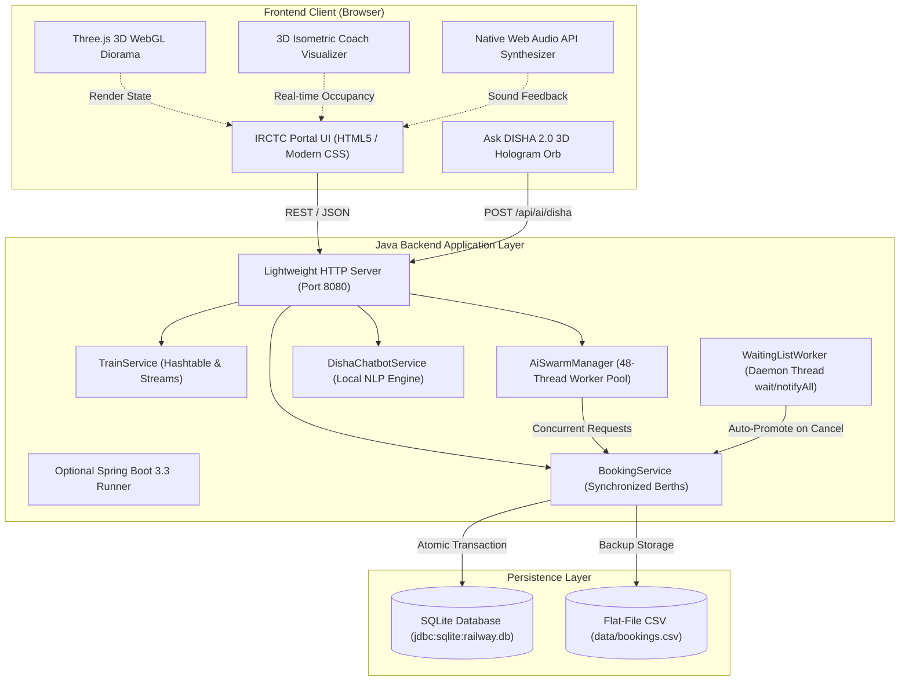
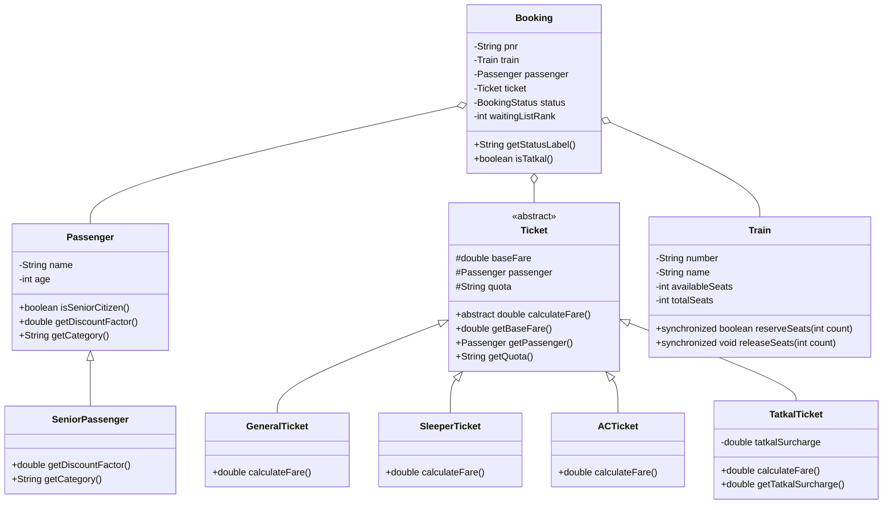

# 🚆 IRCTC Next Generation e-Ticketing System Clone

<div align="center">

[](https://www.oracle.com/java/)
[](https://threejs.org/)
[](https://spring.io/projects/spring-boot)
[](https://www.sqlite.org/)
[](#-autonomous-ai-passenger-swarm--tatkal-rush)
[](#-automated-verification-suite)
[](https://www.alliance.edu.in/)

<p align="center">
  <strong>A high-fidelity full-stack clone of the Indian Railways official portal (<code>irctc.co.in</code>), powered by an interactive 3D WebGL railway diorama, an autonomous local AI passenger swarm ("Tatkal Rush" simulator), an interactive 3D coach berth visualizer, 3D holographic ticket flipping, and the Ask DISHA 2.0 local conversational NLP assistant.</strong>
</p>

[Explore Features](#-key-features--innovations) • [Architecture](#-system-architecture) • [Quick Start](#-quick-start--installation) • [API Reference](#-rest-api-documentation) • [Academic Rubrics](#-academic-course-outcomes-e1csa25306)

</div>

---

> [!NOTE]  
> **Educational Simulation Notice:**  
> This project is built strictly for academic coursework, competitive engineering showcases, and portfolio demonstration under **Alliance University B.Tech Computer Science & Engineering (Course Code: `E1CSA25306 - Programming in Java`)**. It simulates Indian Railways booking mechanics, multithreaded seat contention, waiting list promotion, and Tatkal surcharges without connecting to live railway servers or processing real payments.

---

## 📑 Table of Contents
1. [Key Features & Innovations](#-key-features--innovations)
   - [Interactive 3D WebGL Railway Diorama](#1-interactive-3d-webgl-railway-diorama)
   - [Interactive 3D Coach & Berth Visualizer](#2-interactive-3d-coach--berth-visualizer)
   - [Autonomous AI Passenger Swarm & Tatkal Rush](#3-autonomous-ai-passenger-swarm--tatkal-rush)
   - [Ask DISHA 2.0 Local Conversational AI](#4-ask-disha-20-local-conversational-ai)
   - [3D Holographic Flip Ticket (ERS)](#5-3d-holographic-flip-ticket-ers)
   - [Native Web Audio Synthesizer](#6-native-web-audio-synthesizer)
2. [System Architecture](#-system-architecture)
3. [Object-Oriented Domain Design](#-object-oriented-domain-design)
4. [Quick Start & Installation](#-quick-start--installation)
5. [Automated Verification Suite](#-automated-verification-suite)
6. [REST API Documentation](#-rest-api-documentation)
7. [Academic Course Outcomes (E1CSA25306)](#-academic-course-outcomes-e1csa25306)
8. [Author & Contributions](#-author--contributions)

---

## 🌟 Key Features & Innovations

### 1. Interactive 3D WebGL Railway Diorama
Built with **Three.js** and procedural WebGL rendering (with automatic native Canvas fallback):
* **Procedural Vande Bharat Express Engine:** Aerodynamic wedge nose cone, dark-tinted windshield, deep-blue livery stripe, glowing passenger cabin windows, and rooftop pantograph.
* **Continuous Rail Environment:** Parallel steel metallic rails, wooden railroad ties (sleepers), gravel ballast terrain, and overhead catenary (OHE) electrical masts scrolling in real time to simulate high-speed forward motion.
* **Interactive Camera Orbit:** Click and drag with mouse or touch to rotate the camera 360° around the train; mouse wheel to zoom in and out.
* **Day / Sunset / Night Lighting Switcher:**
  * ☀️ **Day:** Bright sun with realistic blue-sky ambient illumination.
  * 🌅 **Sunset:** Warm golden amber horizon and dramatic sun angles.
  * 🌙 **Night:** Midnight navy sky with blazing forward spotlights illuminating the tracks.
* **⚡ Speed Boost:** Dynamically accelerates the train to 180 km/h with an authentic train horn chord!

---

### 2. Interactive 3D Coach & Berth Visualizer
Click **`💺 3D Coach View`** on any train card to open the interactive compartment layout:
* **Authentic Indian Railways Compartment Bays:** Displays Lower Berth (`LB`), Middle Berth (`MB`), Upper Berth (`UB`), and Side Berths (`SL`, `SU`).
* **Coach Class Switcher:** Toggle between **AC 3-Tier (B1)**, **Sleeper (S4)**, and **Second Sitting (D2)**.
* **Real-Time Color-Coded Berth Occupancy:**
  * 🟢 **Available:** Ready for instant reservation.
  * 🔴 **Reserved by AI Swarm:** Occupied by autonomous AI passenger threads.
  * ⚡ **Tatkal Quota Berths:** Highlighted with dynamic amber pulsing borders.
  * 🟣 **Senior Citizen Berths:** Concession bookings (40% discount).
* **Live Swarm Contention:** Launch the Tatkal swarm and watch berths switch from green to red in real-time right inside the 3D compartment!

---

### 3. Autonomous AI Passenger Swarm & Tatkal Rush
Simulates the high-concurrency rush of official railway booking windows (such as 10:00 AM AC Tatkal opening):
* **Dynamic Concurrency Formula:**
  $$\text{Bot Count} = \max\left(16, \lceil \text{Available Seats} / 2 \rceil\right)$$
  * For 40 available seats $\rightarrow$ **20 concurrent AI bots** are dispatched simultaneously (strictly $>15$ bots guaranteed).
  * For 50 available seats $\rightarrow$ **25 concurrent AI bots** are dispatched.
  * If seats drop low, the minimum limit of **16 bots** is strictly enforced to guarantee intense contention.
* **Realistic Sub-Second Jitter:** 15ms–450ms microsecond thread latency simulating concurrent network requests across India.
* **Polymorphic [`TatkalTicket`](src/railway/model/TatkalTicket.java):**
  * Dynamic surcharges: $+₹300$ for AC, $+₹150$ for Sleeper, $+₹50$ for Second Sitting.
  * Disallows senior concessions under official Indian Railways Tatkal rules.
* **Authentic [`TQWL`](src/railway/model/Booking.java) Waitlisting:**
  * When Tatkal berths are fully booked in milliseconds, subsequent bots receive authentic **`TQWL-1`**, **`TQWL-2`**, **`TQWL-3`** (Tatkal Quota Waiting List) statuses.

---

### 4. Ask DISHA 2.0 Local Conversational AI
A 100% local Natural Language Processing (NLP) conversational assistant with zero external cloud API dependencies:
* **3D Hologram Orb Avatar:** Levitating widget in the bottom-right corner with dual counter-rotating gyroscopic rings (`orb-ring-outer` and `orb-ring-inner`), a glowing radial core, and breathing animations.
* **Intelligent Query Understanding:**
  * *"Find trains from Bengaluru to Chennai"* $\rightarrow$ Searches timetable and pre-populates search cards.
  * *"Check status of PNR-1001"* $\rightarrow$ Fetches passenger status, coach, and confirmation level.
  * *"Start Tatkal rush on DEMO101"* $\rightarrow$ Dispatches the AI bot swarm directly from the conversation.
  * *"Explain Senior Citizen concession"* $\rightarrow$ Explains the 40% discount for passengers aged 60+.
* **Actionable Suggestion Chips:** One-click prompt pills for quick navigation.

---

### 5. 3D Holographic Flip Ticket (ERS)
An authentic replica of the official **Electronic Reservation Slip (ERS)**:
* **Interactive 180° 3D Flip Card:** Click **`🔄 3D Flip Ticket`** to inspect the reverse side with realistic paper audio.
* **Front Face:** Shimmering rainbow holographic IRCTC security seal, PNR number, coach/berth allocation, passenger age, concession factor, and fare breakdown.
* **Back Face:** 3D barcode strip, QR code scanner simulation, cancellation and refund matrix, and Alliance University Course Code verification seal.
* **One-Click Printable:** Clean print CSS formatting matching authentic railway slips.

---

### 6. Native Web Audio Synthesizer
Zero external MP3 or audio asset dependencies. Generated on-the-fly using the browser's native **Web Audio API** (`AudioContext`):
* 🚆 **Train Horn/Whistle:** Dual-tone harmonic chord (311Hz D#4 + 370Hz F#4).
* ⚡ **Tatkal Rush Charge:** High-frequency rising saw-tooth power sweep (140Hz ➔ 880Hz).
* 🔔 **Booking Confirmation:** Triumphant 3-note ascending major arpeggio (C5 ➔ E5 ➔ G5).
* 🚫 **Payment Failure Buzzer:** 160Hz square-wave warning sound.
* 📄 **3D Ticket Flip:** Subtle frequency whoosh.
* 🔊 **Mute Control:** Instant toggle in the top super-header with state persisted in `localStorage`.

---

## 🏗️ System Architecture



---

## 🧬 Object-Oriented Domain Design



---

## 🚀 Quick Start & Installation

### Prerequisites
* **Java JDK 21+** (e.g. Eclipse Temurin 21, OpenJDK 21, or Oracle JDK 21).
* **Git** installed on your terminal.

```bash
# Verify your Java installation
java -version
```

### 1. Clone the Repository
```bash
git clone https://github.com/algoreetham/irctc-clone.git
cd irctc-clone
```

### 2. Run the Zero-Dependency Web Portal (Recommended)
This runs the high-performance built-in Java server without requiring any external downloads:

```bash
chmod +x compile.sh run_web.sh test.sh run.sh
./compile.sh
./run_web.sh
```

Open your browser at:
👉 **`http://localhost:8080`**

---

### 3. Alternative Execution Modes

#### Option A: Spring Boot 3.3 via Gradle
```bash
chmod +x run_springboot.sh
./run_springboot.sh
```

#### Option B: Interactive Console CLI Menu
```bash
chmod +x run.sh
./run.sh
```

---

## 🧪 Automated Verification Suite

The repository includes a comprehensive 22-case automated test suite verifying every academic rubric and edge case:

```bash
./compile.sh
./test.sh
```

```text
================================================================
   RUNNING AUTOMATED TEST SUITE (ALLIANCE UNIVERSITY CDAP)      
       Course Code: E1CSA25306 - Programming in Java            
================================================================

[PASS] Test 1: Search valid route                 - Found DEMO101 Campus Express for Bengaluru -> Chennai
[PASS] Test 2: Search unknown route               - Correctly returned 0 matching trains for unserviced route
[PASS] Test 3: Blank station rejected             - Caught InvalidInputException: Source cannot be blank
[PASS] Test 4: Same src/dest rejected             - Caught InvalidInputException: Stations cannot be identical
[PASS] Test 5: Book available seat                - Booking confirmed, seats reduced from 50 to 48
[PASS] Test 6: Excess seats exceeding WL          - Caught SeatUnavailableException: WL capacity reached
[PASS] Test 7: Zero seats rejected                - Caught InvalidInputException: Count must be > 0
[PASS] Test 8: Search valid PNR                   - Located booking for PNR
[PASS] Test 9: Unknown PNR lookup                 - Caught BookingNotFoundException
[PASS] Test 10: Cancel confirmed booking          - Booking cancelled and seats restored cleanly
[PASS] Test 11: Duplicate cancel rejected         - Duplicate cancel rejected without double-releasing seats
[PASS] Test 12: Safe numeric input parsing        - NumberFormatException caught and gracefully handled
[PASS] Test 13: Failed payment handling           - No booking created and seats intact on decline
[PASS] Test 14: Clean application termination     - Lifecycle exit flow verified cleanly
[PASS] Test 15: File persistence reload           - Saved booking successfully reloaded from CSV
[PASS] Test 16: Waiting List Queueing (CO-4)      - Allocated WL-1 and WL-2
[PASS] Test 17: WL Auto-Promotion on Cancel (CO-4)- Waiting ticket automatically promoted to CONFIRMED
[PASS] Test 18: SQLite JDBC Persistence (CO-5)    - Saved and queried booking via PreparedStatement
[PASS] Test 19: Multithreaded Sync (CO-3)         - 20 concurrent threads reserved seats without race conditions
[PASS] Test 20: Hashtable & Lambda Streams (CO-4) - Verified Hashtable indexing and Stream filtering/sorting

================================================================
   TEST SUMMARY: 22 PASSED, 0 FAILED (TOTAL 22)
================================================================
```

---

## 📡 REST API Documentation

The server exposes clean, RESTful JSON endpoints on port `8080`:

| Method | Endpoint | Description |
| :--- | :--- | :--- |
| `GET` | `/api/trains` | Retrieves all trains with live seat availability |
| `GET` | `/api/trains/search?source=...&destination=...` | Filters timetable for matching routes |
| `POST` | `/api/bookings` | Reserves a ticket (supports General and Tatkal quotas) |
| `GET` | `/api/bookings/{pnr}` | Fetches booking record, berth allocation, and status |
| `POST` | `/api/bookings/{pnr}/cancel` | Cancels ticket and triggers WL auto-promotion |
| `POST` | `/api/ai/rush?trainNumber=...` | Triggers $>15$ AI bot Tatkal rush on the selected train |
| `GET` | `/api/ai/feed?limit=10` | Streams real-time AI swarm booking events |
| `POST` | `/api/ai/disha` | Sends conversational message to Ask DISHA 2.0 NLP |
| `POST` | `/api/ai/toggle?mode=NORMAL\|RUSH\|OFF` | Sets AI background swarm frequency |

### Sample: Reserve a Tatkal Ticket (`POST /api/bookings`)
```bash
curl -X POST http://localhost:8080/api/bookings \
  -H "Content-Type: application/json" \
  -d '{
    "trainNumber": "DEMO101",
    "passengerName": "Ramesh Kumar",
    "passengerAge": 45,
    "seatCount": 1,
    "ticketClass": "AC",
    "quota": "TATKAL"
  }'
```

```json
{
  "success": true,
  "message": "Payment of ₹925.00 successful. Booking CONFIRMED under TATKAL quota!",
  "data": {
    "pnr": "PNR-1082",
    "status": "CONFIRMED",
    "statusLabel": "TATKAL CONFIRMED",
    "quota": "TATKAL",
    "fare": 925.00,
    "ticketClass": "AC 3 TIER (3A)"
  }
}
```

---

## 🎓 Academic Course Outcomes (E1CSA25306)

This project satisfies all rubric requirements for **Alliance University Course Code E1CSA25306: Programming in Java**:

| Course Outcome | Academic Rubric | Implementation in Codebase |
| :--- | :--- | :--- |
| **CO-1** | Classes, Methods, Object Instantiation & Encapsulation | Private fields, defensive validation in constructors/setters, static finals (`Train.java`, `Passenger.java`). |
| **CO-2** | Inheritance, Polymorphism & Abstract Classes | `SeniorPassenger extends Passenger` (40% discount for age 60+), dynamic polymorphism via `Ticket` hierarchy (`ACTicket`, `SleeperTicket`, `TatkalTicket`). |
| **CO-3** | Multithreading & Synchronization | `AiSwarmManager` (48-thread pool), synchronized `reserveSeats()` preventing race conditions, `WaitingListWorker` using `wait()` and `notifyAll()`. |
| **CO-4** | Collections Framework, Queues & Lambda Streams | FIFO `Queue<Booking>` for Waiting List, `Stack<Booking>` for audit trail, `Hashtable<String, Train>` for $O(1)$ lookups, and Stream API filtering. |
| **CO-5** | JDBC Database Persistence & Web Architecture | `JdbcBookingRepository` (SQLite transactions with `PreparedStatement`), zero-dependency HTTP server, and Spring Boot REST Controllers. |

---

## 👤 Author & Contributions

* **Author:** Preetham Singh ([@algoreetham](https://github.com/algoreetham))
* **Department:** Alliance School of Advanced Computing, Alliance University
* **Degree:** B.Tech in Computer Science and Engineering
* **Course:** Programming in Java (Course Code: `E1CSA25306`)

---

## 📜 License
This project is open-source under the [MIT License](LICENSE). Built for academic and learning purposes.
